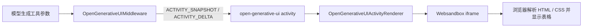
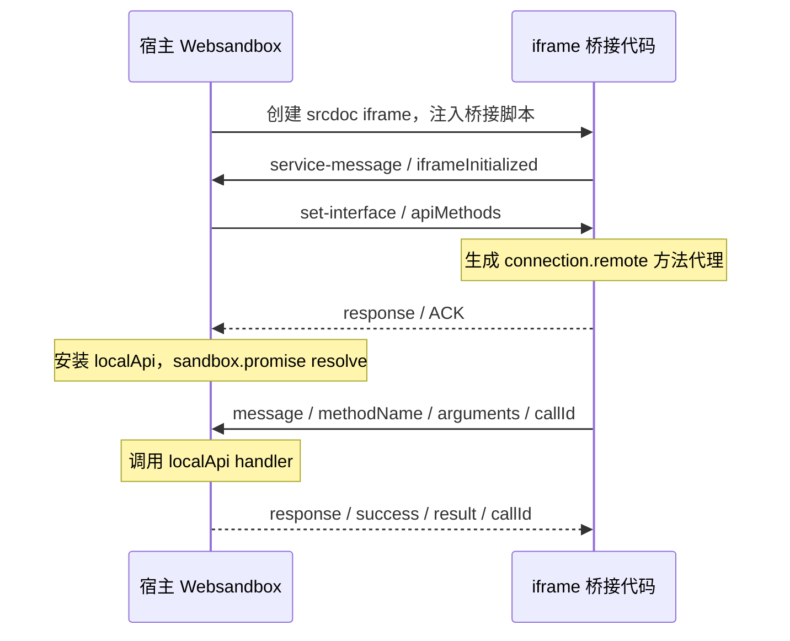

# Websandbox 源码分析：iframe 隔离、JavaScript 执行与宿主通信

本文记录 CopilotKit Open Generative UI 使用 Websandbox 的实现机制，解释模型生成的 HTML 如何进入 iframe、脚本如何执行，以及生成页面如何调用宿主 API。它是固定版本的内部源码分析，不构成跨版本的行为或安全保证。

## 分析范围与源码版本

- 分析日期：2026-10-10。
- CopilotKit 基线：`bbf420baae0019f7ccf0bc406b3454475ce2888c`。
- `packages/react-core/package.json` 声明 `@jetbrains/websandbox: ^1.1.3`，该基线的 `pnpm-lock.yaml` 解析为 `1.1.3`。
- Websandbox 依据 npm 的 `1.1.3` 发布包核对源码；其发布元数据中的 `gitHead` 为 `6477c02fcac5448ae96d65cf6b5c62380dd8365b`。下文上游链接均固定到该提交，不引用浮动的 `main`。

| 源码                                                                                                                     | 主要职责                                                 |
| ------------------------------------------------------------------------------------------------------------------------ | -------------------------------------------------------- |
| [open-generative-ui-middleware.ts](../../packages/shared/src/event-transforms/open-generative-ui-middleware.ts)          | 将工具参数流转换为 AG-UI activity 快照和增量             |
| [CopilotKitProvider.tsx](../../packages/react-core/src/v2/providers/CopilotKitProvider.tsx)                              | 注册 activity renderer 和 `generateSandboxedUi` 前端工具 |
| [OpenGenerativeUIRenderer.tsx](../../packages/react-core/src/v2/components/OpenGenerativeUIRenderer.tsx)                 | 预览、创建最终 iframe、注入 JavaScript、测量高度         |
| [processPartialHtml.ts](../../packages/react-core/src/v2/lib/processPartialHtml.ts)                                      | 提取适合流式预览的部分 HTML 和完整样式                   |
| [websandbox.ts](https://github.com/JetBrains/websandbox/blob/6477c02fcac5448ae96d65cf6b5c62380dd8365b/lib/websandbox.ts) | 宿主侧入口、iframe 创建、初始化和执行接口                |
| [frame.ts](https://github.com/JetBrains/websandbox/blob/6477c02fcac5448ae96d65cf6b5c62380dd8365b/lib/frame.ts)           | iframe 内桥接代码、脚本和样式注入                        |
| [connection.ts](https://github.com/JetBrains/websandbox/blob/6477c02fcac5448ae96d65cf6b5c62380dd8365b/lib/connection.ts) | 双向 `postMessage` RPC、方法代理、请求与响应关联         |

## 1. 为什么模型生成的表格能够直接显示

这条 Open Generative UI 链路中，模型输出的是 `generateSandboxedUi` 工具参数中的 HTML、CSS 和 JavaScript 字符串。开发者预先提供通用的 React 容器、activity renderer 和可调用的宿主函数；具体表格结构、内容与样式由生成结果决定。



中间件使用增量 JSON 解析器读取工具参数，将 HTML 分块追加到 activity 的 `html` 数组，使用 JSON Patch 路径 `/html/-`，并发送 `htmlComplete`、`cssComplete`、`jsExpressions` 等字段。Provider 根据 `activityType: open-generative-ui` 选择对应 renderer，因此这些事件会触发页面显示，无需逐个注册业务表格组件。

Renderer 有两个阶段：

1. **流式预览**：CSS 完成且已有可用 HTML 时，以空 `localApi` 创建预览 iframe，提取部分 HTML，再通过 `run()` 更新 iframe 的 `body.innerHTML` 和样式。预览处理会去掉脚本等不适合部分展示的内容；这不是完整的 HTML 安全净化器。
2. **最终页面**：`htmlComplete` 后拼接全部 HTML，销毁预览 iframe，将 HTML 和 CSS 交给新的 Websandbox。最终实例接收注册的 `sandboxFunctions` 作为 `localApi`，并继续注入 `jsFunctions` 和执行 `jsExpressions`。

`generateSandboxedUi` 的前端工具 handler 固定返回 `UI generated`。这个工具结果用于继续 agent 流程，并没有等待 iframe 的业务脚本或检验表格是否渲染成功。AG-UI 事件、工具成功、页面实际完成是不同层次的状态。

## 2. iframe 隔离如何实现

### 2.1 创建独立文档并注入桥接代码

Websandbox 在宿主 DOM 中创建 iframe。默认将准备后的 HTML 写入 `srcdoc`，然后挂到指定 `frameContainer`；另一种 `frameSrc` 模式加载外部页面，该页面需要自行包含桥接代码。

`_prepareFrameContent()` 通过字符串替换向 `<head>` 注入编译后的 `frame.ts`，还可加入初始化代码、样式和 `<base>`。它没有调用 HTML sanitizer；`validateOptions()` 对 HTML 的主要检查只是是否包含字面的 `<head>`。

插入顺序也影响初始化：桥接脚本位于原始 head 内容之前；同时提供 `codeToRunBeforeInit` 时，实际桥接脚本仍排在它前面。因此该选项名称不能理解为“先于桥接代码执行”。若设置 `baseUrl`，生成的 `<base>` 又位于两者之前。[源码：HTML 准备与 iframe 创建](https://github.com/JetBrains/websandbox/blob/6477c02fcac5448ae96d65cf6b5c62380dd8365b/lib/websandbox.ts#L106-L166)。

### 2.2 核心边界来自浏览器 sandbox 与同源策略

默认 iframe 的 sandbox token 只有 `allow-scripts`，额外 token 由 `sandboxAdditionalAttributes` 追加。它允许 iframe 运行脚本，但没有默认授予 `allow-same-origin`，因此文档具有 opaque origin，消息里的 origin 序列化为 `"null"`。

浏览器由此限制生成脚本直接访问宿主的 DOM、JavaScript 对象及宿主 origin 的存储；iframe 仍可操作自己的 DOM、注册事件、执行脚本。该边界由浏览器实现，Websandbox 负责设置属性并搭建通信桥。[源码：sandbox 属性](https://github.com/JetBrains/websandbox/blob/6477c02fcac5448ae96d65cf6b5c62380dd8365b/lib/websandbox.ts#L150-L164)，[HTML 标准：sandboxed origin](https://html.spec.whatwg.org/multipage/browsers.html#sandboxed-origin-browsing-context-flag)。

需要区分两个选项：

| 选项                          | 写入位置                 | 含义                                                |
| ----------------------------- | ------------------------ | --------------------------------------------------- |
| `sandboxAdditionalAttributes` | iframe 的 `sandbox` 属性 | 增加 sandbox 权限 token，可能改变隔离边界           |
| `allowAdditionalAttributes`   | iframe 的 `allow` 属性   | 配置 Permissions Policy，例如对部分浏览器能力的授权 |

CopilotKit 传入 `allowAdditionalAttributes: ""`，不等于关闭 sandbox；它没有在这里追加 `allow-same-origin`。两种属性的语义由 [HTML 标准的 iframe 定义](https://html.spec.whatwg.org/multipage/iframe-embed-object.html#the-iframe-element) 分别规定。

### 2.3 隔离的适用范围

默认配置阻止直接的同源页面访问，但不提供网络断开、CPU/内存配额或“每次执行都是独立进程”的保证。外部脚本、样式或请求能否成功，还受 CSP、CORS、请求模式和浏览器规则影响。iframe 内的第三方脚本与生成代码共享该页面的执行环境和已暴露的桥接能力。

追加 sandbox token 前应重新评估边界。特别是同源内容同时获得 `allow-scripts` 和 `allow-same-origin` 时，HTML 标准指出存在移除 sandbox 后重新加载的风险。此外，Websandbox 宿主接收端固定期望 origin 为 `"null"`，修改 origin 语义还可能破坏握手。[HTML 标准：iframe sandbox 注意事项](https://html.spec.whatwg.org/multipage/iframe-embed-object.html#attr-iframe-sandbox)。

## 3. JavaScript 如何执行

### 3.1 `run()` 经 RPC 在 iframe 中追加普通 script

调用链是：

```text
宿主 sandbox.run(code)
  → Connection.callRemoteServiceMethod("runCode", code)
  → postMessage 发送 service-message
  → iframe Connection 分发到 Frame.runCode(code)
  → 创建 script，写入代码，追加到 iframe 的 head
  → RPC 返回 Frame.runCode 的返回值
```

`Frame.runCode()` 使用普通 `<script>`，没有设置 `type="module"`、没有 `eval` 返回值协议，也没有自动添加 async 包装。同一 iframe 中的多次调用共享页面上下文，函数和可见的全局绑定可被后续代码使用。[宿主 run 接口](https://github.com/JetBrains/websandbox/blob/6477c02fcac5448ae96d65cf6b5c62380dd8365b/lib/websandbox.ts#L174-L186)，[iframe runCode 实现](https://github.com/JetBrains/websandbox/blob/6477c02fcac5448ae96d65cf6b5c62380dd8365b/lib/frame.ts#L34-L38)。

传入函数时，宿主将函数 `toString()` 后包装成立即调用表达式，再发送给 iframe。函数的宿主闭包不会随源码传递。实现以 `.name` 判断是否走函数分支，而非严格使用 `typeof`，因此不能推断所有匿名函数输入都受同等支持。

### 3.2 `await run()` 不代表业务异步完成

`runCode()` 没有返回脚本求值结果，也没有收集注入脚本创建的 Promise。因此：

| 调用或写法                     | 实际语义                                                           |
| ------------------------------ | ------------------------------------------------------------------ |
| `await sandbox.run("1 + 2")`   | RPC 正常完成时得到 `undefined`，不会得到 `3`                       |
| 注入字符串中的顶层 `await`     | 普通 classic script 中语法不合法                                   |
| 注入 async IIFE                | 可解决顶层 `await` 的语法问题，但 `run()` 不会追踪 IIFE 的 Promise |
| 连续 `await sandbox.run(expr)` | 等待每次 RPC 服务调用完成，不保证前一个脚本的业务异步已完成        |
| `await sandbox.promise`        | 桥接初始化和 API 注册握手完成，不代表图片、外部脚本或业务页面就绪  |

需要业务完成信号时，可以在 iframe 的异步任务结束后显式调用宿主的 `reportResult` 一类 API，并由宿主关联操作 ID、处理成功、失败与超时。该方案是建议的上层契约，当前 Websandbox 的 `run()` 没有提供这一契约。[JavaScript 顶层 await 语法限制](https://developer.mozilla.org/en-US/docs/Web/JavaScript/Reference/Errors/Bad_await)。

### 3.3 脚本异常与 RPC 异常必须分别看待

普通脚本的解析和运行异常通常由浏览器报告到 iframe 的错误处理流程；这里没有监听并转发 `error` 或 `unhandledrejection`。因此不能把 RPC 返回成功视为生成脚本执行成功。`appendChild(script)` 所在服务函数返回，与脚本自身是否正常完成并不是同一个结果。[HTML 标准：classic script 的运行与异常报告](https://html.spec.whatwg.org/multipage/webappapis.html#run-a-classic-script)。

相反，RPC handler 自身若返回 rejected Promise，`Connection` 会发送失败响应；若 handler 同步 throw，当前实现可能没有发出任何响应，详见第 5 节。这两种异常机制不能混为一谈。

`importScript()` 创建外部 script 并等待 `onload`，但没有 `onerror` 或超时处理；加载失败时调用可能一直 pending。它也不提供第三方脚本业务初始化完成的通用保证。[资源注入实现](https://github.com/JetBrains/websandbox/blob/6477c02fcac5448ae96d65cf6b5c62380dd8365b/lib/frame.ts#L40-L58)。

## 4. iframe 与宿主如何通信

### 4.1 握手：公布方法名，在另一端生成代理



宿主将 `localApi` 的方法名展开为路径列表发给 iframe，iframe 将这些路径组装为远程代理。生成页面可通过 `window.Websandbox.connection.remote` 调用宿主注册的函数。代理不会传输函数实现，而是将方法路径和参数封装成消息；真正的 handler 仍在宿主执行。

这使生成页面能够获得受控的业务能力，例如查询数据、通知宿主或触发已注册操作。其权限取决于宿主暴露的函数及 handler 自身的校验，而不是由 `callId` 或代理名称赋予。[初始化握手](https://github.com/JetBrains/websandbox/blob/6477c02fcac5448ae96d65cf6b5c62380dd8365b/lib/websandbox.ts#L80-L103)，[方法公布与代理](https://github.com/JetBrains/websandbox/blob/6477c02fcac5448ae96d65cf6b5c62380dd8365b/lib/connection.ts#L89-L136)。

### 4.2 消息协议与返回值

| `type`            | 用途                     | 关键字段                                  |
| ----------------- | ------------------------ | ----------------------------------------- |
| `set-interface`   | 公布可代理的方法路径     | `callId`、`apiMethods`                    |
| `message`         | 调用另一端业务 API       | `callId`、`methodName`、`arguments`       |
| `service-message` | 调用桥接内部服务         | 同上，例如 `runCode`、`iframeInitialized` |
| `response`        | 响应并完成调用方 Promise | `callId`、`success`、`result`             |

每次调用保存一对 resolve/reject 回调，以递增的 `callId` 关联响应；收到 response 后触发回调并删除记录。参数和结果通过浏览器消息机制复制，不能直接共享 DOM 节点或函数。业务 API 返回 Promise 时，RPC 会等待该 handler 的 Promise；这与 `runCode()` 不返回注入脚本 Promise 的行为有区别。[请求与回调实现](https://github.com/JetBrains/websandbox/blob/6477c02fcac5448ae96d65cf6b5c62380dd8365b/lib/connection.ts#L144-L211)，[响应处理](https://github.com/JetBrains/websandbox/blob/6477c02fcac5448ae96d65cf6b5c62380dd8365b/lib/connection.ts#L218-L274)。

### 4.3 消息来自哪个窗口

发送端使用绑定到目标窗口的 `postMessage`，`targetOrigin` 为 `"*"`。这是向指定窗口发送，不是向所有窗口广播。opaque origin 场景也不能简单替换成宿主 origin 作为发送目标。[postMessage 的目标与 origin 规则](https://developer.mozilla.org/en-US/docs/Web/API/Window/postMessage)。

接收端有两层不同检查：

- **宿主侧**：`event.source` 必须等于该实例的 `iframe.contentWindow`；在非 IE11 路径下，`event.origin` 还必须为 `"null"`。
- **iframe 侧**：`event.source` 必须是 `window.parent`；此处没有额外配置发送方 origin 限制。

`"null"` 本身不能唯一标识某个 iframe，精确的 source 检查同样重要。消息来自目标 iframe，也只说明来源窗口匹配；该窗口中的代码和宿主暴露的 API 仍需按各自信任边界处理。[宿主来源检查](https://github.com/JetBrains/websandbox/blob/6477c02fcac5448ae96d65cf6b5c62380dd8365b/lib/websandbox.ts#L81-L94)，[iframe 来源检查](https://github.com/JetBrains/websandbox/blob/6477c02fcac5448ae96d65cf6b5c62380dd8365b/lib/frame.ts#L6-L18)，[Connection origin 检查](https://github.com/JetBrains/websandbox/blob/6477c02fcac5448ae96d65cf6b5c62380dd8365b/lib/connection.ts#L55-L82)。

### 4.4 CopilotKit 的高度消息走独立通道

Renderer 在生成结束时尝试安排一次高度测量：effect 运行时必须已存在最终 sandbox，若桥接尚未 ready 则先入队。测量代码读取 `body.scrollHeight` 和 margin，再向 parent 发送 `{ type: "__ck_resize", height }`。宿主检查 source 和消息 type，更新 React 容器高度。

这是应用自行定义的单向消息，不经过 Websandbox 的 `callId` RPC，也没有持续监听所有布局变化。该 effect 只依赖 `generationDone`；若运行时最终 sandbox 尚未创建，它会直接返回，之后的 ref 更新不会触发重跑，因此测量也可能被错过。即使完成测量，后续图片加载或异步 DOM 变化仍可能改变高度。对应实现位于 renderer 的 `Effect 4`。

## 5. 已确认的执行和生命周期限制

以下结论用于理解当前代码，文档没有修改这些实现。

| 行为                                   | 源码原因                                                                                  | 对调用方的影响                                                      |
| -------------------------------------- | ----------------------------------------------------------------------------------------- | ------------------------------------------------------------------- |
| RPC handler 同步 throw 可能不回包      | `method.call(...)` 先执行，再将返回值传给 `Promise.resolve()`；外层 `.catch()` 尚未建立   | 调用方可能长期 pending；应将同步调用纳入统一异常处理                |
| 异步 rejection 可以回包                | handler 正常返回 Promise 后进入 `.then().catch()`                                         | 调用方 reject，但 Error 被转换为普通对象，通常不保留标准 stack/name |
| 未提供统一 timeout/cancel              | 回调记录依赖 response 才删除                                                              | 丢失响应、加载失败或实例销毁后，未决调用没有统一结束机制            |
| `destroy()` 只移除 iframe 和宿主监听器 | 没有主动 reject 未决调用或清理全部调用状态                                                | 不能将销毁等同于取消所有 Promise                                    |
| CopilotKit 执行队列完成语义有限        | ready 后 flush 队列没有逐项 await；常规表达式循环虽 await `run()`，也没有追踪业务 Promise | 注入顺序与业务完成顺序应分别定义                                    |
| 表达式进度先于执行结果更新             | `executedIndexRef` 在执行前推进                                                           | 不能把该索引当成脚本成功记录，失败后也没有自动重试协议              |

上述 RPC 差异来自 [消息分发](https://github.com/JetBrains/websandbox/blob/6477c02fcac5448ae96d65cf6b5c62380dd8365b/lib/connection.ts#L55-L78)、[本地调用](https://github.com/JetBrains/websandbox/blob/6477c02fcac5448ae96d65cf6b5c62380dd8365b/lib/connection.ts#L144-L164) 与 [销毁实现](https://github.com/JetBrains/websandbox/blob/6477c02fcac5448ae96d65cf6b5c62380dd8365b/lib/websandbox.ts#L169-L172)。

可优先改进的上层契约包括：为业务任务定义明确的完成/失败消息；为 RPC 增加超时和销毁取消；统一捕获 handler 同步异常与异步 rejection；收集 iframe 的脚本错误并关联执行 ID；若内容持续变化则使用持续尺寸通知。实施前需要分别设计语义和兼容性，本次只形成分析记录。

## 6. 验证范围与安全披露

已核对锁定版本的 Websandbox 发布包、发布元数据和当前 CopilotKit 调用代码，并在隔离 Node 子进程中验证 RPC 同步异常、异步失败响应等行为。浏览器的 opaque origin、classic script 和消息语义依据 HTML 标准及相关浏览器 API 文档解释。

本次没有完成真实浏览器中的端到端 iframe 测试、CSP 组合测试、资源配额或进程隔离测试，也没有据此证明完整宿主逃逸。原始 AG-UI 记录能够说明内容和事件的流转；仅凭事件记录，无法确认浏览器是否成功完成脚本执行和最终布局。文档未收录原始日志中的业务数据。

涉及安全问题的具体复现与披露应遵守仓库 [Security Policy](../../SECURITY.md)，通过规定的私下渠道处理；公开技术文档不包含相应攻击载荷或复现步骤。本次没有向外部人员发送安全报告。
